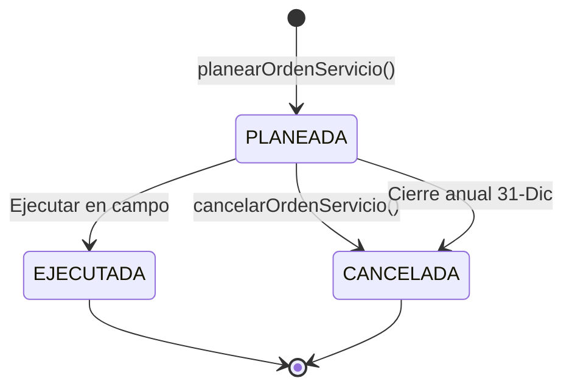
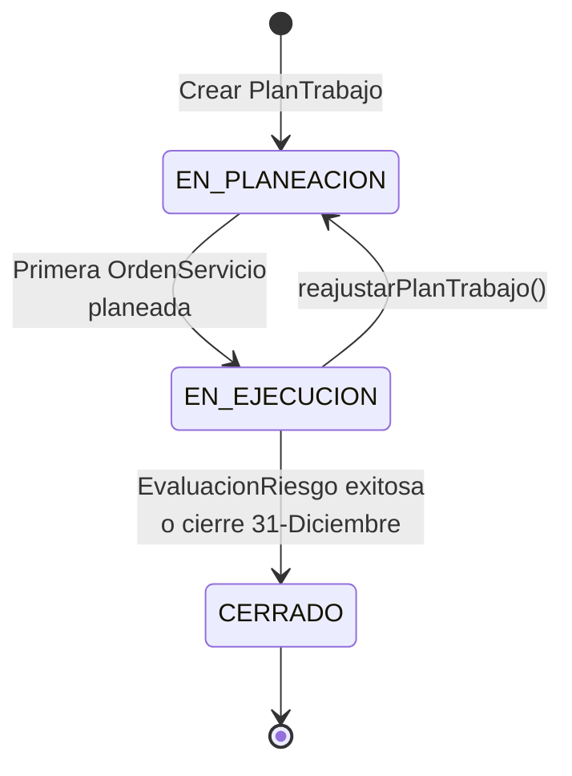
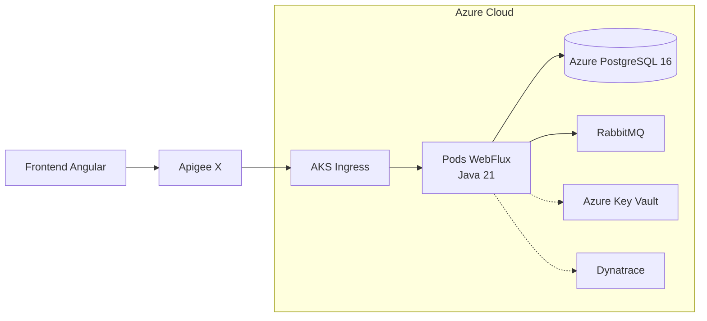

# Diseño Técnico: Plataforma de control de presupuesto de prevención

## 1. Arquitectura general y Stack tecnológico
Para soportar hasta 250 usuarios concurrentes y 7.500 transacciones diarias con consistencia financiera estricta (cero saldos negativos), se adopta una Arquitectura Hexagonal (Scaffold Clean Architecture), alineada con la línea base tecnológica de SURA:

- **Backend:** Java 21, Spring Boot 3.3 y WebFlux (programación reactiva no bloqueante).
- **Base de Datos:** PostgreSQL 16 (acceso vía Spring Data R2DBC).
- **Mensajería (Eventos):** RabbitMQ utilizando la librería Reactive Commons.
- **Frontend:** Angular (Standalone Components) con NgRx Signal Store para el manejo de estado reactivo.
- **Exposición y Despliegue:** APIs OpenAPI 3.1 gobernadas en Apigee X, desplegadas en contenedores sobre Azure AKS y monitoreadas con Dynatrace.
- **Pruebas de Integración:** Testcontainers (`postgres:16-alpine` y `rabbitmq:3.13-alpine`) con `@ServiceConnection` para validar bloqueos concurrentes reales, restricciones `CHECK` y mensajería sin depender de bases en memoria.

Organización de Módulos, acorde al Scaffold Hexagonal:
- `domain/model`: Entidades puras del negocio (Ej. `PresupuestoAnual`, `OrdenServicio`) e interfaces (Gateways). Cero dependencias de frameworks.
- `domain/usecase`: Orquestación de las reglas de negocio (`RN-01` a `RN-10`) utilizando flujos reactivos (`Mono`/`Flux`).
- `infrastructure/entry-points`: Controladores reactivos (Handlers REST) que exponen la API hacia Apigee X.
- `infrastructure/driven-adapters`: Implementación técnica de base de datos (PostgreSQL/R2DBC) y publicación de eventos (RabbitMQ).

---

## 2. Modelo de Datos (Lenguaje Ubicuo)
Las tablas reflejan fielmente el modelo de dominio, respetan los nombres oficiales definidos en [01-contexto.md](./01-contexto.md) y delegan en la base de datos la protección de la consistencia financiera frente a la concurrencia.

### Relaciones Core
- `GrupoPrevencion` (1) ── (N) `Usuario` y `EmpresaAfiliada`
- `EmpresaAfiliada` (1) ── (N) `PresupuestoAnual` *(Uno activo por vigencia fiscal)*
- `EmpresaAfiliada` (1) ── (N) `PlanTrabajo` *(Uno activo por vigencia fiscal)*
- `PlanTrabajo` (1) ── (N) `OrdenServicio` *(Unidad indivisible)*
- `OrdenServicio` (1) ── (0..1) `EvaluacionRiesgo`

### Esquema Físico (PostgreSQL)
Las reglas de negocio limitantes (`RN-01` y `CB-04`) se blindan mediante restricciones `CHECK` físicas.

```sql
CREATE TABLE presupuesto_anual (
  id UUID PRIMARY KEY,
  empresa_afiliada_id UUID NOT NULL REFERENCES empresa_afiliada(id),
  vigencia INT NOT NULL, -- Ej: 2026 (RN-03)
  monto_asignado NUMERIC(15, 2) NOT NULL CHECK (monto_asignado >= 0),
  saldo_comprometido NUMERIC(15, 2) NOT NULL DEFAULT 0 CHECK (saldo_comprometido >= 0),
  saldo_ejecutado NUMERIC(15, 2) NOT NULL DEFAULT 0 CHECK (saldo_ejecutado >= 0),
  saldo_disponible NUMERIC(15, 2) NOT NULL CHECK (saldo_disponible >= 0), -- Bloquea sobregiros
  version BIGINT NOT NULL DEFAULT 0, -- Manejo de concurrencia (@Version en Spring Data)
  CONSTRAINT uq_empresa_vigencia UNIQUE (empresa_afiliada_id, vigencia),
  CONSTRAINT chk_ecuacion_presupuestal CHECK (
    saldo_disponible = monto_asignado - saldo_comprometido - saldo_ejecutado
  )
);

CREATE TABLE plan_trabajo (
  id UUID PRIMARY KEY,
  empresa_afiliada_id UUID NOT NULL REFERENCES empresa_afiliada(id),
  vigencia INT NOT NULL,
  estado VARCHAR(20) NOT NULL CHECK (estado IN ('EN_PLANEACION', 'EN_EJECUCION', 'CERRADO')),
  creado_en TIMESTAMPTZ NOT NULL DEFAULT NOW(),
  CONSTRAINT uq_plan_empresa_vigencia UNIQUE (empresa_afiliada_id, vigencia)
);

CREATE TABLE orden_servicio (
  id UUID PRIMARY KEY,
  plan_trabajo_id UUID NOT NULL REFERENCES plan_trabajo(id),
  prestador_id UUID NOT NULL,
  profesional_prevencion_id UUID NOT NULL,
  valor_total NUMERIC(15, 2) NOT NULL CHECK (valor_total > 0),
  estado VARCHAR(20) NOT NULL CHECK (estado IN ('PLANEADA', 'EJECUTADA', 'CANCELADA')),
  fecha_programada DATE NOT NULL,
  creado_en TIMESTAMPTZ NOT NULL DEFAULT NOW()
);
```

---

## 3. Máquina de estados y concurrencia

### Ciclo de vida de `OrdenServicio`

| Estado | Actor / disparador | Impacto presupuestal | Reglas aplicables |
| :--- | :--- | :--- | :--- |
| **PLANEADA** | `ProfesionalPrevencion` (`planearOrdenServicio()`) | `SaldoDisponible - valor_total` → `SaldoComprometido + valor_total` | **RN-01**, **RN-02**, **RN-05** (Tarifa inmutable) |
| **EJECUTADA** | `Prestador` (Ejecución en campo) | `SaldoComprometido - valor_total` → `SaldoEjecutado + valor_total` | **RN-06** (Irreversible, sin reembolso), **RN-08** |
| **CANCELADA** | `ProfesionalPrevencion` (`cancelarOrdenServicio()`) / Batch 31-Dic | `SaldoComprometido - valor_total` → `SaldoDisponible + valor_total` | **RN-04** (Cierre vigencia), **CB-05** (Estado terminal) |

### Ciclo de Vida de `PlanTrabajo`

| Estado | Actor / disparador | Impacto presupuestal | Reglas aplicables |
| :--- | :--- | :--- | :--- |
| **EN_PLANEACION** | `ProfesionalPrevencion` (Creación o `reajustarPlanTrabajo()`) | Sin movimiento directo (al reajustar conserva intacto el `SaldoEjecutado` previo) | **RN-07** (Ciclo PHVA), **RN-08** |
| **EN_EJECUCION** | Sistema (Al planear la primera `OrdenServicio`) | Los movimientos ocurren a nivel de cada `OrdenServicio` | **RN-01**, **RN-02** |
| **CERRADO** | `ProfesionalPrevencion` (`EvaluacionRiesgo` exitosa) / Batch 31-Dic | Cierre del ciclo; órdenes `PLANEADA` pendientes se cancelan y liberan saldo | **RN-03** (Vigencia anual), **RN-04** |

- Concurrencia Reactiva (CB-04): Al reservar presupuesto, el adaptador R2DBC abrirá un `TransactionalOperator` ejecutando un `SELECT ... FOR UPDATE` sobre la fila del `presupuesto_anual`. Si dos peticiones llegan al mismo milisegundo, la base de datos las encola, evitando que WebFlux procese saldos negativos.

---

## 4. Idempotencia y eventos de dominio
- **Idempotencia (CB-01):** Todas las transacciones de modificación (crear, ejecutar o cancelar órdenes) exigirán un header HTTP `X-Idempotency-Key` válido. Si la llave ya existe en la tabla de idempotencia, se retorna el éxito guardado previamente sin duplicar movimientos.
- **Integración asíncrona:** Se implementará el patrón `Transactional Outbox`. En la misma transacción de la base de datos donde se mueve el dinero, se guarda un registro del evento. Un proceso reactivo leerá esta tabla y publicará en **RabbitMQ** (vía `Reactive Commons`) los eventos: **PresupuestoReservado**, **PresupuestoConsumido** o **PresupuestoLiberado**.

---

## 5. Contratos de API y Seguridad

### 5.1 Endpoints Core (Apigee X → Spring WebFlux)
La especificación completa de esquemas, códigos HTTP y ejemplos se encuentra desacoplada en el contrato [openapi.yaml](./anexos/openapi.yaml). Todas las peticiones exigen `Authorization: Bearer <jwt>` y las mutables requieren `X-Idempotency-Key` (`CB-01`).

| Historia / HT | Caso de Uso / Acción | Método y Ruta | Rol Autorizado |
| :--- | :--- | :--- | :--- |
| **HT-002** | `asignarPresupuestoAnual()` | `POST /api/v1/empresas-afiliadas/{empresaAfiliadaId}/presupuestos` | `LiderPrevencion` |
| **HU-3 / HT-010** | Consultar saldos empresa | `GET /api/v1/empresas-afiliadas/{empresaAfiliadaId}/presupuesto` | `LiderPrevencion` |
| **HT-010** | Consultar plan de trabajo propio | `GET /api/v1/planes-trabajo/mi-empresa` | `RepresentanteSST` |
| **HT-010** | Solicitar servicios de prevención | `POST /api/v1/planes-trabajo/mi-empresa/solicitudes` | `RepresentanteSST` |
| **HU-1 / HT-012** | `planearOrdenServicio()` | `POST /api/v1/planes-trabajo/{planTrabajoId}/ordenes-servicio` | `ProfesionalPrevencion` |
| **HU-2 / HT-009** | Ejecutar orden en campo | `PATCH /api/v1/ordenes-servicio/{ordenServicioId}/ejecutar` | `Prestador` |
| **HU-2 / HT-009** | `cancelarOrdenServicio()` | `PATCH /api/v1/ordenes-servicio/{ordenServicioId}/cancelar` | `ProfesionalPrevencion` |
| **HT-004 / HT-013** | Registrar evaluación y `reajustarPlanTrabajo()` | `POST /api/v1/ordenes-servicio/{ordenServicioId}/evaluaciones` | `ProfesionalPrevencion` |

### 5.2 Errores de Negocio (`CB-02`) y Seguridad RBAC (`RN-08`, `RN-09`, `RN-10`)
* **Formato estándar de error:** Cualquier infracción a las reglas (`RN-01` a `RN-10`) responde bajo **RFC 7807** (`application/problem+json` con códigos `422`, `403` o `409`) devolviendo los campos estándar (`type`, `title`, `status`, `detail`, `instance`) junto con `codigoRegla`, `error` y `timestamp` en lenguaje de negocio, sin exponer trazas técnicas.
* **Propagación pura de identidad (`ContextoUsuario`):** Spring Security WebFlux valida el rol contra la ruta en los *entry-points* y mapea los *claims* del JWT (`usuarioId`, `rol`, `grupoPrevencionId`) hacia un objeto puro `ContextoUsuario`, evitando dependencias de seguridad dentro de `domain/usecase`.
* **Propiedad y aislamiento de datos (`RN-09`, `CB-03`):** En `HU-2`, el caso de uso verifica que el `usuarioId` del `Prestador` coincida con el `prestador_id` asignado a la `OrdenServicio`. En `HU-3` y `HT-002`, el adaptador R2DBC filtra obligatoriamente por `grupo_prevencion_id` para el `LiderPrevencion`, negando con `403 Forbidden` cualquier operación sobre empresas de otro grupo sin revelar sus saldos. Para `RepresentanteSST` (`HT-010`), las consultas y solicitudes se restringen estrictamente a su `empresaAfiliadaId` asociada en el token.

---

## 6. Arquitectura de Despliegue en Azure (Cloud & IaC)

La solución se despliega sobre **Microsoft Azure** bajo un modelo de servicios gestionados (PaaS Platform As A Service/CaaS Containers As A Service) para garantizar alta disponibilidad y escalabilidad automática:

- **Cómputo (Azure AKS):** Contenedores Docker (alojados en **Azure Container Registry - ACR**) ejecutándose en nodos de **Azure Kubernetes Service**, con autoescalado horizontal (HPA) basado en CPU/memoria para absorber picos de hasta 250 usuarios concurrentes.
- **Persistencia (Azure Database for PostgreSQL):** Instancia gestionada *Flexible Server* (PostgreSQL 16) con respaldo automático y alta disponibilidad en zona redundante.
- **Gestión de Secretos (Azure Key Vault):** Almacenamiento centralizado de cadenas de conexión R2DBC y credenciales de RabbitMQ, inyectados en los pods mediante *Secrets Store CSI Driver*.
- **Gobierno y Observabilidad:** **Apigee X** enruta el tráfico HTTPS hacia el *Ingress Controller* interno de AKS, mientras **Dynatrace** monitorea el rendimiento de los pods y las consultas reactivas.

